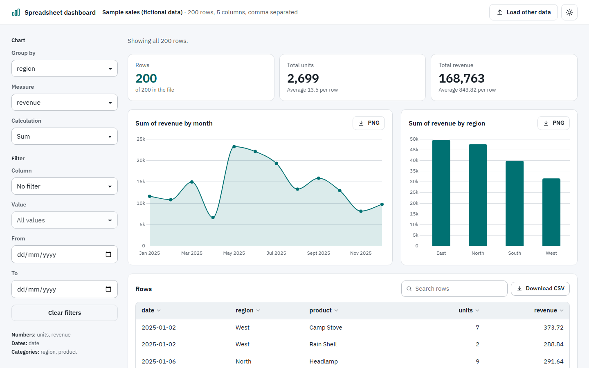
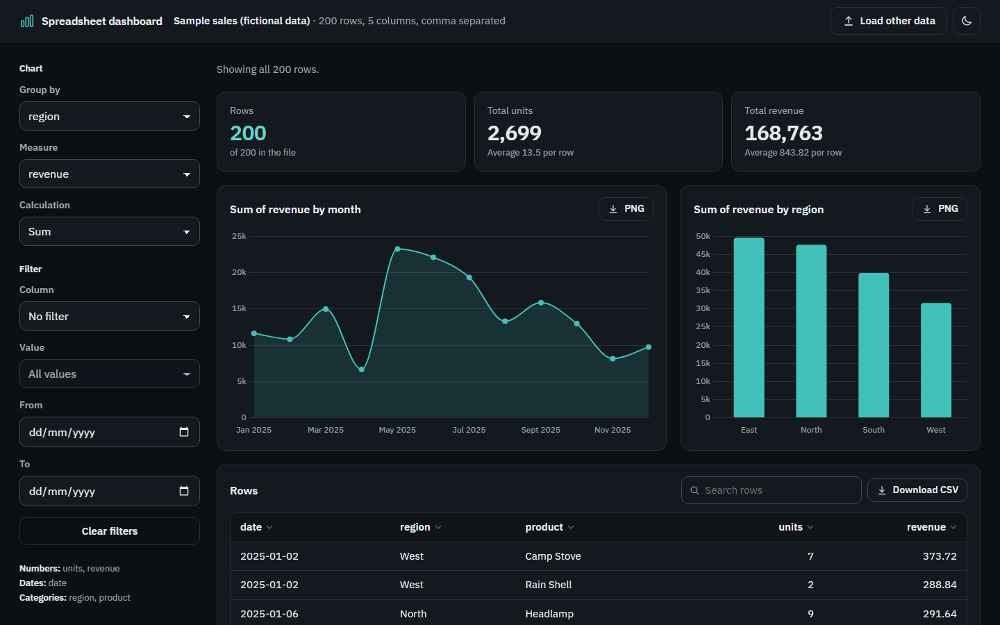
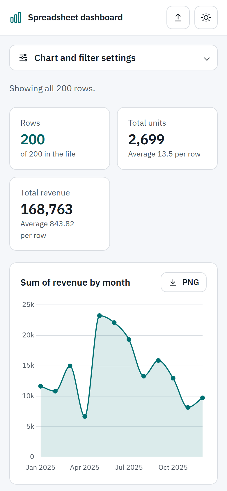

# Leo's starter: Dashboard from a spreadsheet

Drop a CSV file (or paste one, or load the sample) and get an instant dashboard: key numbers, a
chart over time, a grouped bar chart and a searchable table. Everything runs in your browser. Your
data never leaves your device. No build step, no server code, no trackers. Part of Leo's starters
from [Replore](https://replore.cardzo.co.in), a Cardzo product.



| Dark theme | Phone |
| --- | --- |
|  |  |

## What you get

- **Three ways in:** drag and drop a file (anywhere on the page), choose one, or paste CSV text.
- **Robust parsing** with Papa Parse: quoted fields, commas inside quotes, line breaks inside
  quotes, and comma, semicolon, tab or pipe separators.
- **Column types detected for you:** numbers (including `1,234.50`, `1.234,50`, `$99`, `(10)`),
  dates (`2025-03-25`, `25/03/2025`, `03/25/2025`, `5 Jan 2025`) and categories.
- **Key numbers:** row count plus the total and average of up to three number columns, with
  count-up motion when filters change.
- **Over time chart** when the file has a date column. It picks days, weeks or months for you.
- **Grouped bar chart:** choose the column to group by, the measure, and sum, average or count.
- **Filters:** by any category column and by date range.
- **Table:** sort by any column, search, and page through rows.
- **Exports:** each chart as PNG, and the rows you are looking at (filters plus search) as CSV.
  Exported CSV cells that could run as spreadsheet formulas are made safe.
- Light and dark themes, keyboard friendly, labelled controls, works on phones.
- Reduced motion respected: no count-ups or chart animation.

## Quick start

1. **Try it.** Double-click `index.html`, then click **Try the sample sales data**. The sample in
   `sample-sales.csv` is fictional: 200 made-up sales of outdoor gear in 2025 with date, region,
   product, units and revenue. (`sample-sales.js` holds the same data so the sample also loads when
   the page is opened straight from disk.)
2. **Use your own data.** Drop a CSV onto the page. The first row must be the column names. To make
   your own data the default, replace `sample-sales.csv`, paste the same text into the string in
   `sample-sales.js`, and change the label in `loadSample()` in `app.js`.
3. **Deploy it.** Pick one:

   **GitHub Pages**
   1. Create an empty repository on GitHub, for example `dashboard`.
   2. In this folder run:
      ```
      git remote add origin https://github.com/YOUR-NAME/dashboard.git
      git push -u origin main
      ```
   3. On GitHub open **Settings > Pages**. Under **Build and deployment** choose
      **Source: Deploy from a branch**, then **Branch: main** and **/ (root)**, and click **Save**.
   4. After a minute it is live at `https://YOUR-NAME.github.io/dashboard/`.

   **Cloudflare Pages**
   1. In the Cloudflare dashboard open **Workers & Pages > Create > Pages**.
   2. Choose **Upload assets**, give the project a name and click **Create project**.
   3. Drag this whole folder onto the upload box and click **Deploy site**.
   4. Or choose **Connect to Git** instead, pick your repository, set **Framework preset: None**,
      leave **Build command** empty and set **Build output directory** to `/`.

   **Netlify**
   1. Go to https://app.netlify.com/drop and drag this folder onto the page.
   2. Or in Netlify choose **Add new site > Import an existing project**, pick your repository,
      leave **Build command** empty and set **Publish directory** to `.`.

   A deployed copy is still private by design: visitors' files are read by their own browser and
   are never sent to your host.

## Customising

- **Colours and font:** tokens at the top of `styles.css`, one block for light and one for dark.
  The font is embedded in `fonts/fonts.css` so it works even from disk; replace its `@font-face`
  rule and `--font` to change it.
  Charts read `--accent`, `--ink`, `--muted`, `--line` and `--panel`, so they follow your palette.
- **Key numbers:** `renderKpis()` in `app.js`. By default it skips number columns whose names look
  like IDs, years, zip codes or phone numbers.
- **Chart look:** `chartOptions()` and `renderCharts()` in `app.js` (standard Chart.js options).
- **Number of bars:** `TOP_GROUPS` in `app.js` (extra groups are folded into "Other").
- **Load data from code:** `window.leoDashboard.load(csvText, "My data")`.
- **Without GSAP:** delete the `vendor/gsap/gsap.min.js` script tag. Everything still works; the
  numbers just appear without counting up.

## Limits

- Files up to 100 MB are accepted, but very large files (several hundred thousand rows) will feel
  slow because everything runs in one browser tab.
- Excel files (`.xlsx`) are not read directly. Save as CSV first.
- Date detection covers common formats. Unusual formats are treated as text.

## Credits

- Built by Cardzo for Replore. Code: MIT licence, see `LICENSE`.
- [Chart.js](https://www.chartjs.org) (MIT) for charts.
- [Papa Parse](https://www.papaparse.com) (MIT) for CSV parsing.
- [GSAP](https://gsap.com) for motion, under the Standard "No Charge" GSAP License, which is not
  MIT. Read `NOTICE.md` before selling or redistributing this template.
- Font: IBM Plex Sans, SIL Open Font License.
- Design guidance: [Impeccable](https://github.com/pbakaus/impeccable).

Full licence details, versions and download sources are in `NOTICE.md`.
