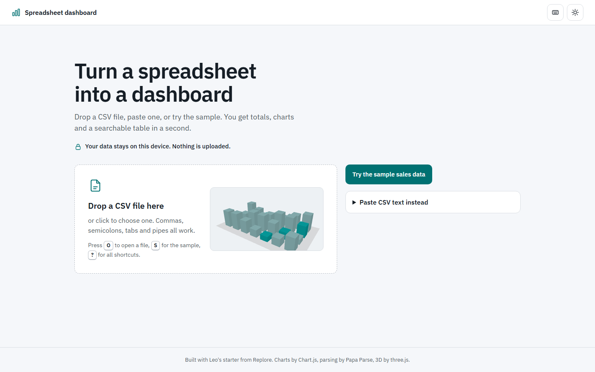
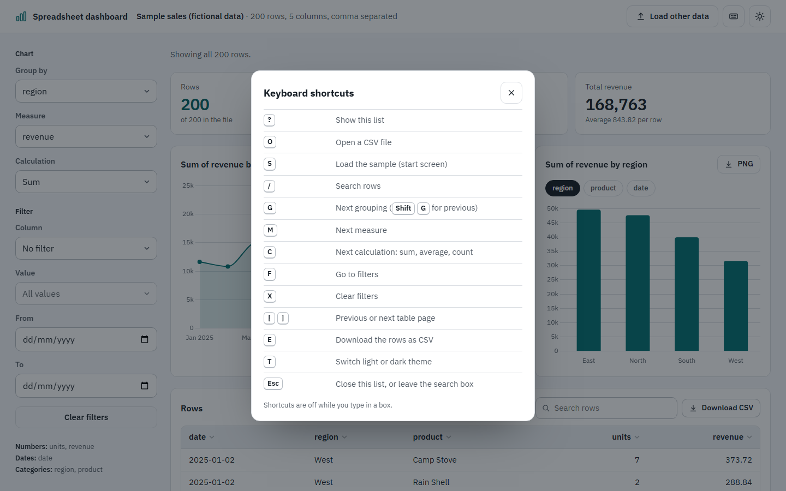
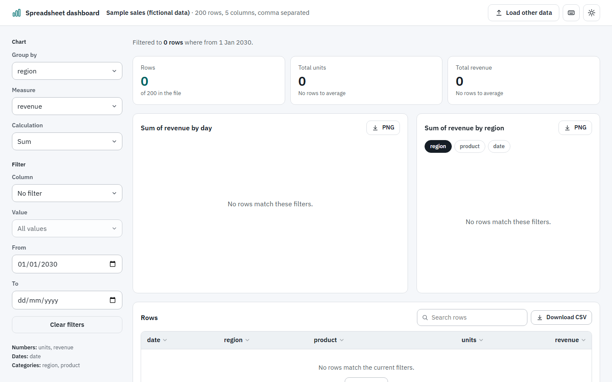

# Leo's starter: Dashboard from a spreadsheet

Drop a CSV file (or paste one, or load the sample) and get an instant dashboard: key numbers, a
chart over time, a grouped bar chart and a searchable table. Everything runs in your browser. Your
data never leaves your device. No build step, no server code, no animation library, no trackers.
Part of Leo's starters from [Replore](https://replore.cardzo.co.in), a Cardzo product.


| Dark theme | Phone |
| --- | --- |
|  |  |

| Start screen with the 3D field | Keyboard shortcuts | Nothing matches the filters |
| --- | --- | --- |
|  |  |  |

## What you get

- **Three ways in:** drag and drop a file (anywhere on the page), choose one, or paste CSV text.
- **A start screen worth landing on:** a small 3D bar field (three.js) in the drop area that
  breathes slowly and lifts when you drag a file over the page, a "Reading" state for big files,
  and a calm whole-window drop card once a dashboard is open. Without WebGL, with reduced motion,
  or when the page is opened from disk, a drawn preview of the same size shows instead.
- **Robust parsing** with Papa Parse: quoted fields, commas inside quotes, line breaks inside
  quotes, and comma, semicolon, tab or pipe separators.
- **Column types detected for you:** numbers (including `1,234.50`, `1.234,50`, `$99`, `(10)`),
  dates (`2025-03-25`, `25/03/2025`, `03/25/2025`, `5 Jan 2025`) and categories.
- **Key numbers** with count-up transitions when filters change.
- **Over time chart** when the file has a date column. It picks days, weeks or months for you.
- **Grouped bar chart** with grouping chips above it. Switching grouping, measure or calculation
  cross-fades the chart with the View Transitions API where the browser has it.
- **Filters** by any category column and by date range. When nothing matches, the charts and the
  table say so and offer a one-click "Clear filters".
- **Table:** sort by any column, search, and page through rows.
- **Keyboard shortcuts:** press `?` for the list. `O` open a file, `S` sample, `/` search,
  `G` next grouping, `M` next measure, `C` next calculation, `F` filters, `X` clear filters,
  `[` and `]` pages, `E` download CSV, `T` theme. Changes made from the keyboard apply instantly,
  with no animation, because shortcuts are used many times a day.
- **Exports:** each chart as PNG, and the rows you are looking at as CSV. Exported cells that
  could run as spreadsheet formulas are made safe.
- Light and dark themes, keyboard friendly, labelled controls, works on phones.
- **Fast with large files:** 10,000 rows load in about 90 ms and filter in under 10 ms on a
  laptop (measured in headless Chrome with generated data).
- Reduced motion respected: no count-ups, no chart motion, no 3D; colour fades only.

## Quick start

1. **Try it.** Double-click `index.html`, then click **Try the sample sales data**. The sample in
   `sample-sales.csv` is fictional: 200 made-up sales of outdoor gear in 2025 with date, region,
   product, units and revenue. (`sample-sales.js` holds the same data so the sample also loads when
   the page is opened straight from disk.)
2. **See the 3D start screen.** Serve the folder (browsers load JavaScript modules only over
   http): `python -m http.server 8000`, then open http://localhost:8000.
3. **Use your own data.** Drop a CSV onto the page. The first row must be the column names. To make
   your own data the default, replace `sample-sales.csv`, paste the same text into the string in
   `sample-sales.js`, and change the label in `loadSample()` in `app.js`.
4. **Deploy it.** Pick one:

   **GitHub Pages**
   1. Create an empty repository on GitHub, for example `dashboard`.
   2. In this folder run:
      ```
      git remote add origin https://github.com/YOUR-NAME/dashboard.git
      git push -u origin main
      ```
   3. On GitHub open **Settings > Pages**. Under **Build and deployment** choose
      **Source: Deploy from a branch**, then **Branch: main** and **/ (root)**, and click **Save**.
   4. After a minute it is live at `https://YOUR-NAME.github.io/dashboard/`.

   **Cloudflare Pages**
   1. In the Cloudflare dashboard open **Workers & Pages > Create > Pages**.
   2. Choose **Upload assets**, give the project a name and click **Create project**.
   3. Drag this whole folder onto the upload box and click **Deploy site**.
   4. Or choose **Connect to Git** instead, pick your repository, set **Framework preset: None**,
      leave **Build command** empty and set **Build output directory** to `/`.

   **Netlify**
   1. Go to https://app.netlify.com/drop and drag this folder onto the page.
   2. Or in Netlify choose **Add new site > Import an existing project**, pick your repository,
      leave **Build command** empty and set **Publish directory** to `.`.

   A deployed copy is still private by design: visitors' files are read by their own browser and
   are never sent to your host.

## Customising

- **Colours and font:** tokens at the top of `styles.css`, one block for light and one for dark.
  The font is embedded in `fonts/fonts.css` so it works even from disk. Charts and the 3D field
  read `--accent`, `--ink`, `--muted`, `--line` and `--panel`, so they follow your palette.
- **Key numbers:** `renderKpis()` in `app.js`. By default it skips number columns whose names look
  like IDs, years, zip codes or phone numbers.
- **Chart look:** `chartOptions()` and `renderCharts()` in `app.js` (standard Chart.js options).
- **Number of bars:** `TOP_GROUPS` in `app.js` (extra groups are folded into "Other").
- **Shortcuts:** the `shortcuts` map in `app.js` and the list in `index.html`.
- **Motion:** `motion.js` (Web Animations API). The 3D field is `start3d.js`; delete the
  `loadStartField` call in `app.js` to keep only the drawn preview.
- **Load data from code:** `window.leoDashboard.load(csvText, "My data")`.

## Limits

- Files up to 100 MB are accepted, but very large files (several hundred thousand rows) will feel
  slow because everything runs in one browser tab.
- Excel files (`.xlsx`) are not read directly. Save as CSV first.
- Date detection covers common formats. Unusual formats are treated as text.

## Safe AI coding with Governor

This template comes with [Governor](https://github.com/chittychat-studio/Governance-manager)
pre-installed: a safety kit for AI coding agents in Claude Code (and advisory rules for Codex).

**What it does.** When you open this folder in Claude Code, Governor's rules stop the agent from
reading secret files such as `.env`, wiping folders with `rm -rf` or `Remove-Item -Recurse
-Force`, force-pushing, piping downloaded scripts into a shell, or switching its own safety off.
It asks you before production deploys, package installs, web fetches and commands that call paid
AI services, and it scans every file the agent writes for API keys. This template is set to
tier 3, the strictest, because people will drop spreadsheets that may hold personal data and the
page is meant to be public. Every rule is listed, as enforced or advisory, in
`.claude/governor/COVERAGE.md`.

**What was added:** `governance.yaml` (the answers and the tier), `.claude/settings.json`,
`.claude/hooks/` (small Python scripts, standard library only), `.claude/rules/governor.md` and a
marked block in `CLAUDE.md` and `AGENTS.md`. The dashboard never loads any of it. The hooks need
Python 3.11 or newer. After cloning, restart Claude Code once so the hooks load.

**Refresh it** when your project changes (logins, a database, a server, tests): install the
plugin with `/plugin marketplace add chittychat-studio/Governance-manager` and
`/plugin install governor@chittychat-governor`, then run `/governor:init` in this folder.
`/governor:status` shows what is blocked and what needs your OK.

**Remove it:** run `/governor:remove`. It shows what would be removed and prints a command for you
to run yourself in a terminal outside Claude Code (the agent is not allowed to remove its own
guardrails). Without the plugin, delete `governance.yaml`, the `.claude/` folder and the
`<!-- governor:start -->` to `<!-- governor:end -->` blocks in `CLAUDE.md` and `AGENTS.md`.

## Credits

- Built by Cardzo for Replore. Code: MIT licence, see `LICENSE`.
- [Chart.js](https://www.chartjs.org) (MIT) for charts.
- [Papa Parse](https://www.papaparse.com) (MIT) for CSV parsing.
- [three.js](https://threejs.org) (MIT) for the 3D start field. All other motion uses browser
  features only.
- [Governor](https://github.com/chittychat-studio/Governance-manager) (MIT) for AI coding
  guardrails.
- Font: IBM Plex Sans, SIL Open Font License.
- Design and motion guidance (no code copied): Impeccable, Emil Kowalski's design engineering
  skills and taste-skill. See `NOTICE.md`.

Full licence details, versions and sources are in `NOTICE.md`.
